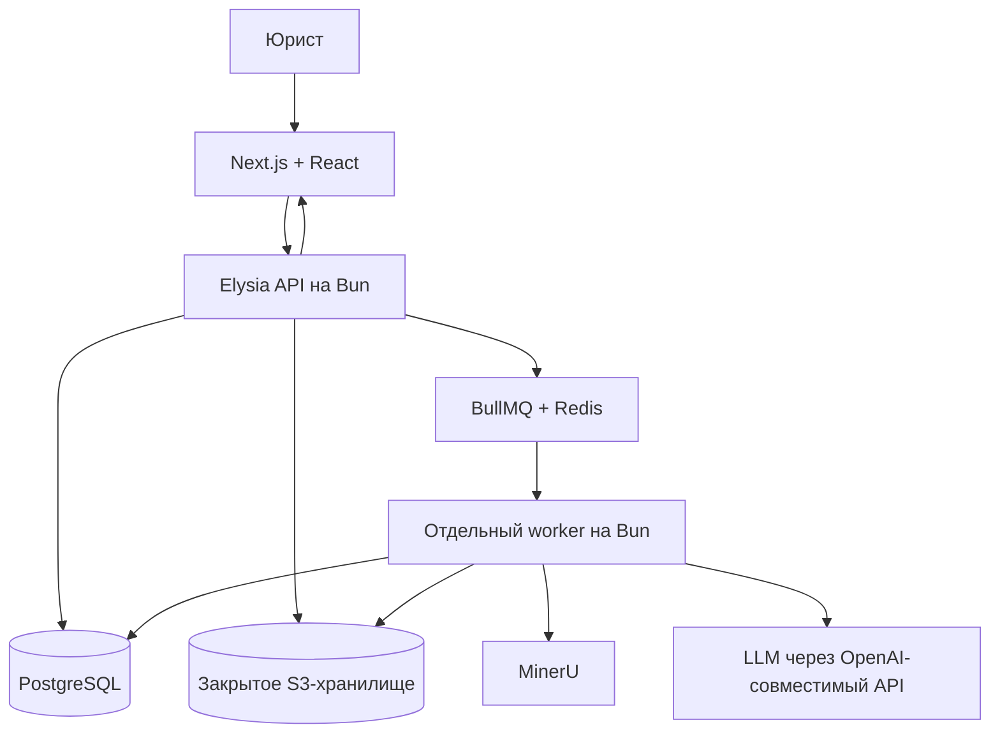

# Архитектура Anyko

Дата решения: 5 ноября 2026 года. Статус: принято для реализации MVP.

Продуктовые границы и крупные задачи описаны в [mvp.md](../mvp.md). Задачи и спецификации разработки ведутся в GitHub Issues репозитория `kindyakov/anyko`. Этот документ фиксирует устройство системы и границы ответственности.

## 1. Выбранная структура

**Next.js + React — фронтенд; Elysia + Bun — серверный API; отдельный worker на Bun — фоновая обработка.**

Приложение строится как модульный монолит в одном репозитории с общей моделью дела. Фронтенд, API и worker имеют отдельные точки запуска. Разделение процессов позволяет выполнять длительные задачи независимо от пользовательских запросов; оно не требует отдельных микросервисов для каждой бизнес-сущности.

Elysia выбран для разработки API на Bun. Hono, Fastify, NestJS и Koa не являются дополнительными серверными слоями этого решения. Сам выбор фреймворка не подтверждает совместимость всей связки: она проверяется при реализации сквозного сценария.

## 2. Компоненты и границы

| Компонент | Ответственность |
| --- | --- |
| Next.js + React | Страницы, рендеринг, навигация, формы, отображение файлов, сведений и состояния задач |
| Elysia + Bun | HTTP API, аутентификация и проверка прав, операции с делами и документами, правки юриста, настройки провайдеров LLM, постановка задач и выдача результатов |
| Worker + Bun | Выполнение очереди: разбор файлов, вызовы MinerU и LLM, извлечение и сопоставление фактов, генерация DOCX, сохранение результатов и ошибок |
| Общие TypeScript-модули | Бизнес-правила, схемы Zod, работа с данными и интеграциями, используемые API и worker |
| MinerU | Отдельный Python-сервис для OCR, разбора структуры и таблиц |
| PostgreSQL + Prisma | Состояние дел, источники, подтверждения, история изменений и результаты обработки |
| BullMQ + Redis | Очередь фоновых задач и управление повторными попытками |
| Закрытое S3-хранилище | Исходники, промежуточные материалы, подготовленный шаблон и заявления |
| Внешняя LLM | Извлечение фактов через OpenAI-совместимый API с выбранным провайдером и моделью |

Next.js не обращается напрямую к базе для бизнес-операций и не дублирует API в Route Handlers или Server Actions. Серверный рендеринг может получать данные через Elysia API с пользовательским контекстом доступа. API остаётся границей проверки прав, даже если интерфейс скрывает недоступное действие.

Worker не вызывается напрямую из браузера. Общие бизнес-правила не зависят от контекста Elysia или Next.js; API и worker вызывают их как обычные TypeScript-модули. В браузер передаются только нужные схемы и типы, без серверных интеграций, доступа к БД и секретов.

## 3. Поток обработки

1. Фронтенд отправляет действие в API. API проверяет доступ и сохраняет необходимые данные.
2. Для длительной обработки API ставит задачу в очередь и возвращает её идентификатор и состояние.
3. Worker выполняет этапы, сохраняет промежуточные результаты и доступный пользователю статус. OCR, LLM и сборка Word не удерживают пользовательский HTTP-запрос открытым на всё время работы.
4. Фронтенд получает актуальное состояние через API. Закрытие вкладки не отменяет задачу.
5. Юрист подтверждает или исправляет сведения через API. Новая генерация заявления выполняется worker по снимку данных и версии шаблона.

Подтверждённые сведения и результаты извлечения разделены. Повторные попытки не создают дубли и не перезаписывают ручные исправления автоматически. Состояние дела сохраняется в PostgreSQL; очередь не является единственным источником пользовательского прогресса.

## 4. Контракты и интеграции

Zod остаётся выбранным инструментом проверки данных, включая ответы LLM. HTTP-контракты Elysia согласуются с общей схемой дела; отдельные несовместимые определения одних и тех же полей не вводятся. Способ подключения схем и клиентской типизации определяется при реализации без изменения границ компонентов.

Настройки LLM хранятся на сервере. При запуске задачи фиксируются подключение, модель и параметры; смена активного провайдера действует на новые задачи. Worker обращается к провайдеру через общий модуль OpenAI-совместимого API. Подключение локальной модели через тот же интерфейс возможно позднее.

Генерация выполняется через docxtemplater и PizZip по одному подготовленному DOCX. LLM извлекает факты, но не формирует свободный текст заявления.

## 5. Размещение

Для MVP фронтенд, API и worker запускаются отдельными процессами или контейнерами под управлением Docker Compose. Их можно разместить на одном сервере; ресурсоёмкий MinerU может работать на отдельной машине.

Снаружи используется один домен. Входной прокси направляет страницы в Next.js, а `/api` — в Elysia. База, очередь и MinerU доступны внутренним компонентам. API-ключи LLM не попадают в браузер и обычные технические логи.

Worker можно масштабировать отдельно от API с учётом ограничений MinerU и провайдера LLM. Переход к нескольким обработчикам не должен менять правила сохранения подтверждённых данных и защиты от повторного выполнения.

## 6. Проверка при реализации

Первый сквозной сценарий проверяет загрузку документа из Next.js через Elysia, сохранение данных через Prisma, выполнение задания worker через BullMQ, получение результата и сборку Word на Bun. Отдельно проверяются права доступа, повторный запуск задачи и восстановление отображения прогресса после закрытия вкладки.

Документ фиксирует архитектурное решение. Реализация и результаты runtime-проверок в рамках этой правки не выполнялись.
