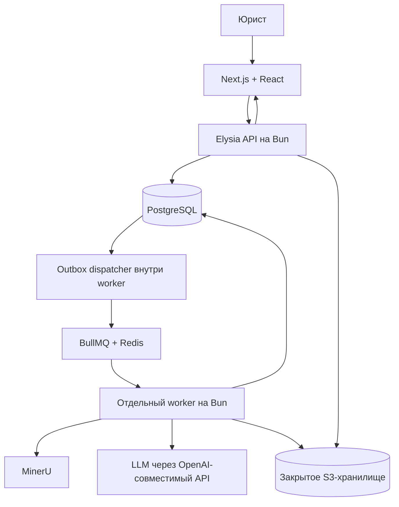

# Архитектура Anyko

Выбранная организация кода: [feature-based web и модульный backend с ports/adapters](adr/0004-code-organization.md). API — HTTP-адаптер, worker — адаптер очереди; оба вызывают независимые серверные сценарии. Разделение по процессам не создаёт второго владельца бизнес-логики.

Дата решения: 5 ноября 2026 года. Статус: принято для реализации MVP.

Продуктовые границы и крупные задачи описаны в [mvp.md](../mvp.md). Задачи и спецификации разработки ведутся в GitHub Issues репозитория `kindyakov/anyko`. Этот документ фиксирует устройство системы; детальные правила находятся в [инженерной основе](engineering/README.md), будущие возможности — в [направлениях развития](roadmap.md).

## 1. Выбранная структура

**Next.js + React — фронтенд; Elysia + Bun — серверный API; отдельный worker на Bun — фоновая обработка.**

Приложение строится как модульный монолит в одном репозитории с общей моделью дела. Фронтенд, API и worker имеют отдельные точки запуска. Разделение процессов позволяет выполнять длительные задачи независимо от пользовательских запросов; оно не требует отдельных микросервисов для каждой бизнес-сущности.

В Bun workspace три приложения: `apps/web`, `apps/api`, `apps/worker`. Серверные предметные модули живут в `packages/backend`; отдельные пакеты содержат HTTP-контракты, механизм БД, UI и общие конфигурации. Полное дерево, разрешённые зависимости и порядок добавления модулей — в [repository.md](engineering/repository.md). Папки будущих функций создаются вместе с реализацией, а не заранее.

Elysia выбран для разработки API на Bun. Hono, Fastify, NestJS и Koa не являются дополнительными серверными слоями этого решения. Сам выбор фреймворка не подтверждает совместимость всей связки: она проверяется при реализации сквозного сценария.

## 2. Компоненты и границы

| Компонент                   | Ответственность                                                                                                                                            |
| --------------------------- | ---------------------------------------------------------------------------------------------------------------------------------------------------------- |
| Next.js + React             | Страницы, рендеринг, навигация, формы, отображение файлов, сведений и состояния задач                                                                      |
| Elysia + Bun                | HTTP API, аутентификация и проверка прав, операции с делами и документами, правки юриста, настройки провайдеров LLM, постановка задач и выдача результатов |
| Worker + Bun                | Выполнение очереди: разбор файлов, вызовы MinerU и LLM, извлечение и сопоставление фактов, генерация DOCX, сохранение результатов и ошибок                 |
| Серверные предметные модули | Владельцы бизнес-правил, данных и интеграций; API и worker используют их публичные интерфейсы                                                              |
| HTTP-контракты и UI         | Отдельные browser-safe схемы/DTO и компоненты; без Prisma, серверных секретов и интеграций                                                                 |
| MinerU                      | Отдельный Python-сервис для OCR, разбора структуры и таблиц                                                                                                |
| PostgreSQL + Prisma         | Состояние дел, источники, подтверждения, история изменений и результаты обработки                                                                          |
| BullMQ + Redis              | Очередь фоновых задач и управление повторными попытками                                                                                                    |
| Закрытое S3-хранилище       | Исходники, промежуточные материалы, подготовленный шаблон и заявления                                                                                      |
| Внешняя LLM                 | Извлечение фактов через OpenAI-совместимый API с выбранным провайдером и моделью                                                                           |

Next.js не обращается напрямую к базе для бизнес-операций и не дублирует API в Route Handlers или Server Actions. Серверный рендеринг может получать данные через Elysia API с пользовательским контекстом доступа. API остаётся границей проверки прав, даже если интерфейс скрывает недоступное действие.

Доступ строится вокруг пользователя, рабочей области и membership. Better Auth выбран адаптером аутентификации на стороне API; бизнес-права проверяет модуль `access`. В MVP достаточно закрытого допуска в одну область, но запросы и связи данных имеют scope с начала. Политики доступа, владельцы таблиц и контекст worker определены в [data-and-jobs.md](engineering/data-and-jobs.md).

Worker не вызывается напрямую из браузера. Общие бизнес-правила не зависят от контекста Elysia или Next.js; API и worker вызывают их как обычные TypeScript-модули. В браузер передаются только нужные схемы и типы, без серверных интеграций, доступа к БД и секретов.

Текущий контур работ по пакету документов и его операционные ограничения описаны в [work-pipeline.md](engineering/work-pipeline.md). Он использует отдельную работу без сущности Case по [ADR 0005](adr/0005-template-works-and-agent-runtime.md); целевой контекст дел остаётся направлением развития. Работа фиксирует пакет из одного или нескольких шаблонов по [ADR 0006](adr/0006-document-packages.md); первый пакет создаёт три отдельных DOCX из общего снимка сведений.

## 3. Поток обработки

1. Фронтенд отправляет действие в API. API проверяет доступ и сохраняет необходимые данные.
2. Для длительной обработки API атомарно сохраняет запуск и outbox в PostgreSQL и возвращает идентификатор. Dispatcher доставляет задание в BullMQ; недоступность Redis не уничтожает сохранённое намерение.
3. Worker выполняет этапы, сохраняет промежуточные результаты и доступный пользователю статус. OCR, LLM и сборка Word не удерживают пользовательский HTTP-запрос открытым на всё время работы.
4. Фронтенд получает актуальное состояние через API. Закрытие вкладки не отменяет задачу.
5. Юрист подтверждает или исправляет сведения через API. Новая генерация заявления выполняется worker по снимку данных и версии шаблона.

Подтверждённые сведения и результаты извлечения разделены. Повторные попытки не создают второй принятый результат и не перезаписывают ручные исправления автоматически; внешний вызов может повториться после неопределённого исхода. Состояние дела сохраняется в PostgreSQL; очередь не является единственным источником пользовательского прогресса. Отмена, удаление и проверка актуальности попытки действуют перед публикацией результата.

## 4. Контракты и интеграции

Zod остаётся выбранным инструментом проверки данных, включая ответы LLM. `packages/contracts` задаёт HTTP-схемы и выведенные DTO для frontend/API. Доменная модель и Prisma-модель имеют собственные обязанности и отображаются в DTO явно; они не экспортируются в браузер ради общего типа. Wire-контракты не зависят от типов приложения Elysia. Внутренние job envelopes находятся у серверного владельца `processing`, имеют версии и не входят в browser-facing exports. Конкретное подключение Zod к закреплённой версии Elysia проверяется на первой вертикали.

Настройки LLM хранятся на сервере. При запуске задачи фиксируются подключение, модель и параметры; смена активного провайдера действует на новые задачи. Worker обращается к провайдеру через общий модуль OpenAI-совместимого API. Подключение локальной модели через тот же интерфейс возможно позднее.

Принудительный отзыв подключения/секрета останавливает ожидающие и повторные действия, даже если запуск сохранил прежнюю версию. Включение нового профиля или шаблона не меняет старые runs: версии входов, обработчика и шаблона сохраняют воспроизводимое происхождение результата.

Генерация выполняется через docxtemplater и PizZip по одному подготовленному DOCX. LLM извлекает факты, но не формирует свободный текст заявления.

## 5. Размещение

Для MVP фронтенд, API и worker запускаются отдельными процессами или контейнерами под управлением Docker Compose. Их можно разместить на одном сервере; ресурсоёмкий MinerU может работать на отдельной машине.

Снаружи используется один домен. Входной прокси направляет страницы в Next.js, а `/api` — в Elysia. База, очередь и MinerU доступны внутренним компонентам. API-ключи LLM не попадают в браузер и обычные технические логи.

Worker можно масштабировать отдельно от API с учётом ограничений MinerU и провайдера LLM. Переход к нескольким обработчикам не должен менять правила сохранения подтверждённых данных и защиты от повторного выполнения.

Миграции выполняет один release job; API и worker не мигрируют БД при старте каждой реплики. Совместимость payload и схемы сохраняется на время смены релиза. Выпуск, восстановление, наблюдаемость и дальнейшее разделение worker-пулов описаны в [operations.md](engineering/operations.md).

## 6. Проверка при реализации

Первый сквозной сценарий проверяет загрузку документа из Next.js через Elysia, сохранение данных через Prisma, выполнение задания worker через BullMQ, получение результата и сборку Word на Bun. Отдельно проверяются права доступа, повторный запуск задачи и восстановление отображения прогресса после закрытия вкладки.

Документ фиксирует архитектурное решение. Реализация и результаты runtime-проверок в рамках этой правки не выполнялись.

## 7. Расширение продукта

Будущие billing, entitlements и agents добавляются предметными модулями с собственными данными и публичными командами. Операторский интерфейс станет `apps/admin` с отдельным размещением; он использует те же правила доступа и предметные операции API. Шаблоны и виды обработки расширяются через версии и профили, а не через ветвления по тарифам внутри дела. Сервис выделяется при реальной потребности в изоляции или масштабировании, с отдельным решением о данных и протоколе.

Обоснования: [модульный монолит](adr/0001-modular-monolith.md), [граница рабочей области](adr/0002-workspace-ownership.md), [надёжная доставка](adr/0003-durable-processing.md). Инструменты качества, тестовые уровни и независимая проверка являются частью инженерного контракта: [quality.md](engineering/quality.md), [agent-workflow.md](engineering/agent-workflow.md).

## 8. Продолжение агентской сессии

[ADR 0007](adr/0007-persistent-work-agent-session.md) вводит постоянную логическую сессию работы. Добавление документов сохраняет прежний контекст и решения; координатор сопоставляет новые материалы с актуальными фактами через Mastra tools. Отдельные потоки попыток не становятся общей неконтролируемой историей. Принятие состояния защищено редакциями и token запуска, удаление охватывает всю память. Будущий чат вызывает ту же прикладную границу продолжения с новым видом события; его UI/HTTP transport и правила пользовательских сообщений требуют отдельной реализации.
